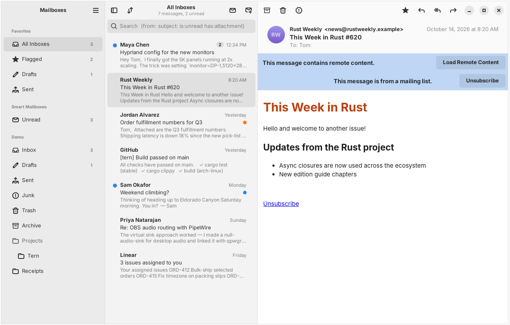

# Tern

An Apple Mail–style email client for Linux, written in Rust with GTK4 and libadwaita.
Built for tiling Wayland desktops (Hyprland), works anywhere GTK does.



## Try it without an account

```sh
cargo run -- --demo
```

Demo mode runs a fake account in memory: read, flag, delete, archive, reply and
send all work, and nothing touches the network or your keyring.

## Status

Milestone 1 (read + compose + send) is in place; see [md/PLAN.md](md/PLAN.md) for the
Apple Mail feature map and what's next.

| Account type | Protocol | Sign-in | Sending |
|---|---|---|---|
| iCloud | IMAP | app-specific password | SMTP |
| Google | IMAP | app password (or OAuth2 in your browser, see below) | SMTP |
| Fastmail | JMAP | API token | JMAP submission |
| Anything else | IMAP | password / app password | SMTP |

## Building on Arch

```sh
sudo pacman -S --needed rust gtk4 libadwaita webkitgtk-6.0 sqlite pkgconf
cargo build --release
./target/release/tern
```

A Secret Service provider must be running to store passwords. On Hyprland, add
one of these to `hyprland.conf`:

```ini
exec-once = gnome-keyring-daemon --start --components=secrets
# or enable "Secret Service integration" in KeePassXC
```

New-mail notifications go through your notification daemon (mako, swaync, dunst).

To install a launcher entry: `install -Dm644 crates/tern/data/dev.tern.Tern.desktop ~/.local/share/applications/`.
To make Tern open `mailto:` links from your browser and other apps:
`xdg-mime default dev.tern.Tern.desktop x-scheme-handler/mailto`. You can also run
`tern 'mailto:ann@example.com?subject=Hi'`; if Tern is already open, the running window handles it.
There is also a `PKGBUILD` (builds from git).

### Hyprland window rules (optional)

```ini
windowrulev2 = float, class:^(dev.tern.Tern)$, title:^(New Message|Re: .*|Fwd: .*)$
windowrulev2 = size 760 640, class:^(dev.tern.Tern)$, title:^(New Message|Re: .*|Fwd: .*)$
```

## Google accounts

The simple way is an **app password**: turn on 2-Step Verification for your Google
account, create an app password at <https://myaccount.google.com/apppasswords>, and enter it
in Add Account → Google (spaces are fine). Use it instead of your regular Google password.
Some Google Workspace (work/school) accounts don't allow app passwords; ask your admin.

### Browser sign-in (OAuth) for developers

Tern doesn't ship a Google-verified OAuth client yet, so browser sign-in needs one of your
own; when it's configured, Add Account → Google offers it as a second sign-in method:

1. In Google Cloud Console, create a project and enable the **Gmail API**.
2. Configure the OAuth consent screen (External, Testing) and add your address as a test user.
3. Create an OAuth client of type **Desktop app**.
4. Export the credentials before launching Tern:

```sh
export TERN_GOOGLE_CLIENT_ID=....apps.googleusercontent.com
export TERN_GOOGLE_CLIENT_SECRET=...   # not confidential for desktop clients
```

## Keyboard

Apple's ⌘ shortcuts map to Ctrl. Single keys work while the message list has focus.

| Action | Shortcut |
|---|---|
| New message | Ctrl+N |
| Reply / Reply All / Forward | Ctrl+R / Ctrl+Shift+R / Ctrl+Shift+F |
| Get mail | Ctrl+Shift+N |
| Mark read/unread | Ctrl+Shift+U, or `u` |
| Flag | Ctrl+Shift+L, or `s` |
| Archive | Ctrl+Alt+A, or `e` |
| Junk | Ctrl+Shift+J |
| Delete | Delete / Backspace (list), Ctrl+Backspace |
| Search | Ctrl+F, Ctrl+Alt+F, or `/` |
| Next / previous message | `j` / `k` |
| Go to All Inboxes | Ctrl+1 |
| Toggle mailboxes pane | Ctrl+Shift+M |
| Send (compose) | Ctrl+Return |

Search understands tokens: `from:ann subject:"q3 invoice" is:unread is:flagged has:attachment after:2026-01-01`.

## Where things live

| What | Path |
|---|---|
| Accounts (no secrets) | `~/.config/tern/accounts.toml` |
| Mail cache + search index | `~/.local/share/tern/mail.db` |
| Passwords and tokens | Secret Service, service `dev.tern.Tern` |

`tern --profile DIR` keeps config and cache under `DIR` instead (handy for testing).

## Development

```sh
cargo test --workspace            # unit + engine tests (no network)
cargo clippy --workspace --all-targets

# Live IMAP test against a throwaway account:
TERN_IMAP_HOST=... TERN_IMAP_USER=... TERN_IMAP_PASS=... \
  cargo test -p tern-imap --test live -- --ignored --nocapture
```

See [CLAUDE.md](CLAUDE.md) for architecture notes and conventions.
